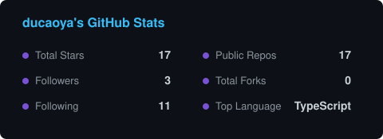
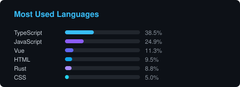

 

## About

I build the tooling I keep wishing existed — extensions for AI coding agents, proxy/debug plugins, and desktop apps that stay out of the way.

**Start with these two:**

- **[pi-hang-guard](https://github.com/ducaoya/pi-hang-guard) — the watchdog for `pi`.** A bash command that produces no output — hung build, stuck dev server — gets caught and flagged with a diagnosis instead of silently hanging your session.
- **[figma-clipboard-design-mcp](https://github.com/ducaoya/figma-clipboard-design-mcp) — Figma design, readable by AI.** Copy layers in Figma and get them back as structured data: layout, fills, text, vector paths, served over a local MCP server. No API quota, no view seat, no dependencies.

Everything else, by area:

- **AI coding-agent extensions.** More plugins for `pi`: async subagent delegation, a full status-bar footer, and web search/extraction.
- **Debug and proxy tooling.** Whistle plugins that make streaming and third-party assets visible: live SSE inspection, SSE mocking, and content-hash disk caching for the Figma desktop client.
- **Desktop apps.** MenuForge, a polished ~1.2 MB Windows context-menu manager (Tauri 2 + Rust); app-uninstaller, a Windows uninstaller that wipes registry and leftover files; compositor-next, cross-platform image compositing with WebGPU.
- **Web clients.** hongguo-web, a third-party short-drama client with 1080P playback, swipe-feed bingeing and resume support.
- **Principle:** no dependency you can avoid, no abstraction you cannot read in one sitting.

## Tech Stack

## Featured Projects

Pinned on my profile — the first two are where I'd start.

| Project | What it does | Stack |
| :--- | :--- | :--- |
| [**pi-hang-guard**](https://github.com/ducaoya/pi-hang-guard) | Watchdog for `pi`: a bash command that goes silent — hung build, stuck dev server — is caught and flagged with a diagnosis instead of freezing the session. | `TypeScript` |
| [**figma-clipboard-design-mcp**](https://github.com/ducaoya/figma-clipboard-design-mcp) | Copy layers in Figma, hand them to an AI as structured data — layout, fills, text, vector paths — over a local MCP server. No API quota, no view seat, no deps. | `JavaScript` `MCP` |
| [**pi-footer-styler**](https://github.com/ducaoya/pi-footer-styler) | Status-bar footer for `pi`: model, thinking level, git branch, tokens, cost, context window, cache hit rate, speed. | `TypeScript` |
| [**whistle-sse-mock-plus-plugin**](https://github.com/ducaoya/whistle-sse-mock-plus-plugin) | Mocks requests as SSE streams: delayed JSON messages, `.jsonl` replay, event/id/data fields, loop mode and a web UI. | `Whistle` |
| [**menuforge**](https://github.com/ducaoya/menuforge) | Polished, lightweight manager for the Windows right-click menu: liquid-glass UI, visual icon picker, batch enable/disable & delete, dead-entry cleanup, auto-backup. ~1.2 MB installer. | `Tauri` `Rust` |
| [**app-uninstaller**](https://github.com/ducaoya/app-uninstaller) | Windows uninstaller that finishes the job: runs the system uninstaller, then sweeps leftover registry keys, AppData folders and shortcuts. Force-uninstall for broken apps, recycle-bin safety net, live per-step logs with cancel. | `Tauri` `Rust` |

<b>More repositories</b>

 

| Project | What it does |
| :--- | :--- |
| [**hongguo-web**](https://github.com/ducaoya/hongguo-web) | Third-party web client for Hongguo short dramas: up to 1080P playback, swipe-feed bingeing and resume support. |
| [**compositor-next**](https://github.com/ducaoya/compositor-next) | Cross-platform image editor for compositing and photo work. Reads and writes the `.comp` project format. |
| [**whistle-sse-viewer**](https://github.com/ducaoya/whistle-sse-viewer) | Adds an SSE tab to Whistle's Response panel: watch and copy `text/event-stream` bodies live, with near-fullscreen view and JSON formatting. |
| [**pi-subagents**](https://github.com/ducaoya/pi-subagents) | Async subagent delegation for `pi`, with truncation, artifacts and session sharing. |
| [**pi-web-access**](https://github.com/ducaoya/pi-web-access) | Web search and content extraction extension for `pi`. |
| [**whistle-figma-cache**](https://github.com/ducaoya/whistle-figma-cache) | Disk-caches the Figma desktop client's static assets so content-hash immutable files replay locally. |
| [**npm-downloads-stats**](https://github.com/ducaoya/npm-downloads-stats) | Zero-dependency static dashboard charting daily, weekly, monthly and yearly npm downloads for any npm user. |
| [**salary-ticker**](https://github.com/ducaoya/salary-ticker) | Salary ticking up in real time — every second on the clock is paid for. |
| [**contracted-photographer**](https://github.com/ducaoya/contracted-photographer) | Static site that turns a photography contract into a uniquely numbered certificate with a 3D plaque, QR verification and double-sided print export. Vue 3 + Vite SSG, no backend. |
| [**claw-code**](https://github.com/ducaoya/claw-code) | Better harness tooling for the leaked Claude Code archive — making it actually do things, rewritten in Rust. |

## GitHub Stats

<picture>
  <source media="(prefers-color-scheme: dark)" srcset="https://raw.githubusercontent.com/ducaoya/ducaoya/output/snake-dark.svg" />
  <source media="(prefers-color-scheme: light)" srcset="https://raw.githubusercontent.com/ducaoya/ducaoya/output/snake-light.svg" />
  
</picture>

